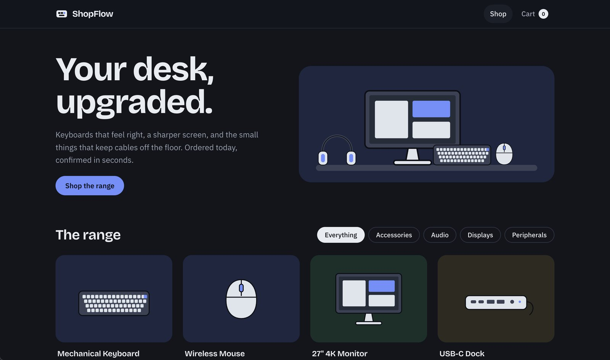
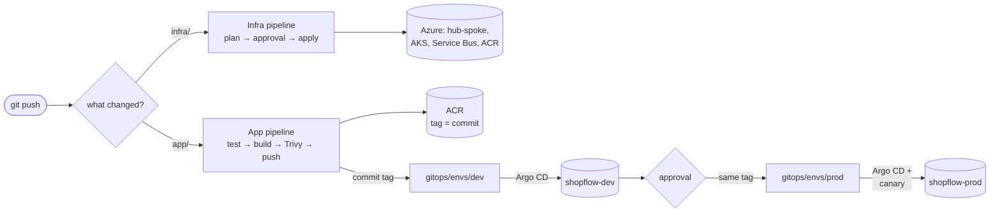
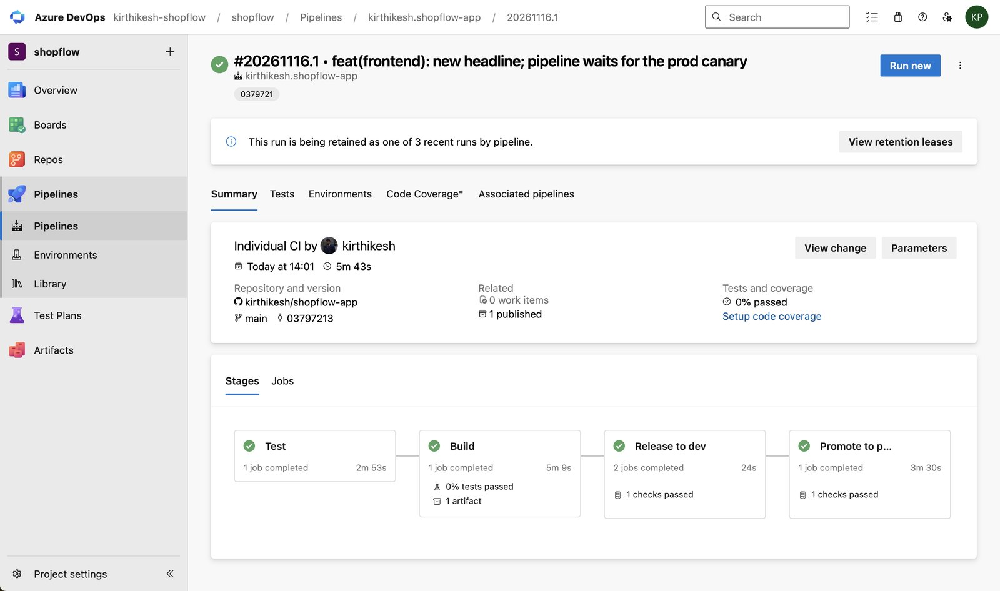
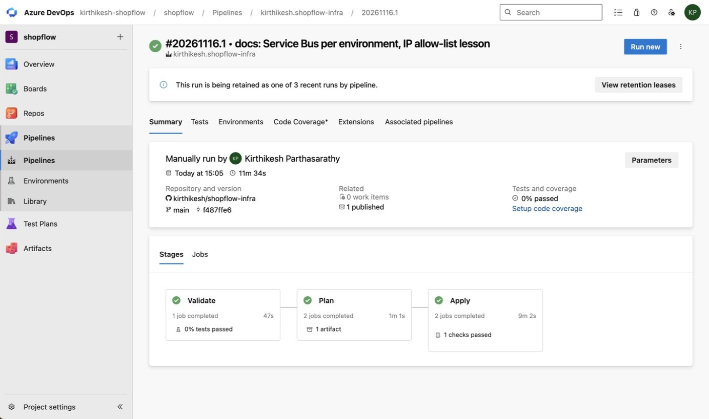
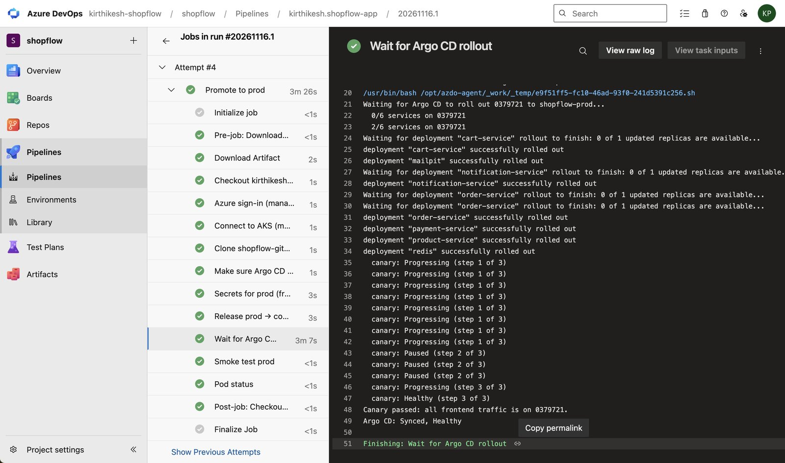

# ShopFlow


An event-driven microservices store and the enterprise Azure platform it runs on, built end to end:
six services in five languages, a Terraform landing zone, AKS, Azure DevOps pipelines that authenticate
with a managed identity, and GitOps releases with Argo CD, including canary releases in prod.

> **Status:** Phases 1–6 and 10 are complete; 7–9 are built, and partly run (see the
> [status table](#roadmap-and-status)). Phases 1–6 ran on Azure, which is now torn down to save
> cost; the screenshots are from the last live release. Phases 7–9 ran on a free local cluster
> ([`local/`](local)), with the results written up.



---

## What's in here

| Folder | What it holds | Pipeline |
|---|---|---|
| [`app/`](app) | Six services (Python, Java, Go, Node, Next.js) over Azure Service Bus, and a local stack that runs it all on a laptop | Test → build + Trivy scan + SBOM → release to dev → approval → promote to prod |
| [`infra/`](infra) | Terraform landing zone (hub-spoke, private DNS, ACR, Key Vault, AKS, Service Bus, guardrails) and the Ansible-built agent | Validate + Trivy IaC → plan → approval → apply the saved plan |
| [`gitops/`](gitops) | Helm chart, per-environment values, the Argo CD ApplicationSet and the canary setup; cluster add-ons in [`gitops/platform`](gitops/platform) | None: Argo CD pulls from it |
| [`local/`](local) | The whole platform on a kind cluster, plus the load, chaos and backup tests | `local/up.sh` |
| [`tests/load`](tests/load) | k6 shopper journey with SLO thresholds | `make load-test` |

Each folder has its own README with the details, the design decisions and the problems I hit along the way.

## How it fits together



- **Each pipeline only runs for its own folder.** The release commit touches `gitops/` only, so it never starts another build.
- **No secrets in Azure DevOps.** The self-hosted agent signs in as its VM's managed identity, with role assignments limited by an ABAC condition. The only stored credential is a deploy key for this repository.
- **Prod runs exactly what dev ran.** Promotion copies the image tag that passed in dev; nothing is rebuilt.
- **Bad releases roll themselves back.** The prod frontend goes out as a canary: 50% of traffic, an automated health check, then 100%, or an automatic rollback.

## Screenshots

| | |
|---|---|
|  |  |
| App pipeline, all four stages | Infra pipeline, apply after approval |
|  |  |
| Prod canary: 50% → health check → 100% | Checkout in prod |

## Quick start

```bash
# The whole platform on a free local Kubernetes cluster (kind)
local/up.sh                # https://shop.localtest.me:9443, Grafana on grafana.localtest.me:9443
make load-test             # k6 with SLO thresholds; KEDA scales product-service

# Just the shop with Docker Compose, including the Service Bus emulator
cd app && make up          # http://localhost:3000

# Build the Azure platform (needs an Azure subscription)
cd infra && make bootstrap && make up
```

## Roadmap and status

✅ done and run · 🟡 built, but parts not run yet · ⬜ not started

| Phase | Status | What ran | What's written but not run yet |
|---|---|---|---|
| 1. Six services, local stack | ✅ | Docker Compose with the Service Bus emulator | |
| 2. Terraform landing zone | ✅ | Azure: hub-spoke, private DNS, remote state, guardrails | |
| 3. AKS and Service Bus | ✅ | Azure: AKS with Workload Identity, Cilium, Entra ID RBAC | |
| 4. Ansible jump box and agent | ✅ | Azure: hardened jump box, self-hosted Azure DevOps agent | |
| 5. Azure DevOps pipelines | ✅ | Azure: templates, Trivy gate, SBOMs, approvals, managed-identity auth | |
| 6. GitOps and canary releases | ✅ | Azure: Argo CD dev and prod, approval-gated promotion, Argo Rollouts canary | |
| 7. Security | 🟡 | Local: Kyverno policies, cert-manager TLS on the Ingress | Azure: Key Vault with Workload Identity, Defender for Containers, Azure Policy, private API server, cosign image signing |
| 8. Observability | 🟡 | Local: Prometheus, Grafana dashboard, SLOs with burn-rate alerts | OpenTelemetry tracing with Tempo |
| 9. Resilience | 🟡 | Local: KEDA autoscaling, k6 load test, Velero backup and restore | Chaos Mesh experiments; restoring Postgres rows in the local drill |
| 10. Write-up | ✅ | This README and [`local/README.md`](local/README.md): results, limits, problems I hit | |

Why the 🟡 parts haven't run: the Azure subscription's credit ended before Phase 7, so the Azure
security pieces are validated with `terraform validate` but not applied, and the laptop the local
platform runs on (8 GB) has no memory left for tracing or Chaos Mesh next to everything else.
Results and limits are in [`local/README.md`](local/README.md).

Next steps:
- Apply the Phase 7 Azure parts on a new subscription and run the pipeline end to end from this repo.
- Run tracing and the chaos test on a machine with 16 GB or more (`make tracing-on`, `make chaos-test`).
- A `pg_dump` pre-backup hook, so the local drill restores Postgres rows too (on AKS, Velero snapshots the Azure Disk).
- In the app: a transactional outbox in the order service, and stock reservation as a saga.

## History

ShopFlow started as three repositories (`shopflow-app`, `shopflow-infra`, `shopflow-gitops`) and was
merged into this one with every commit kept: `git log -- app/` shows the application's full history.
The pipelines and Argo CD now point here. That wiring hasn't run against Azure yet, because the
environment was torn down before the move.
