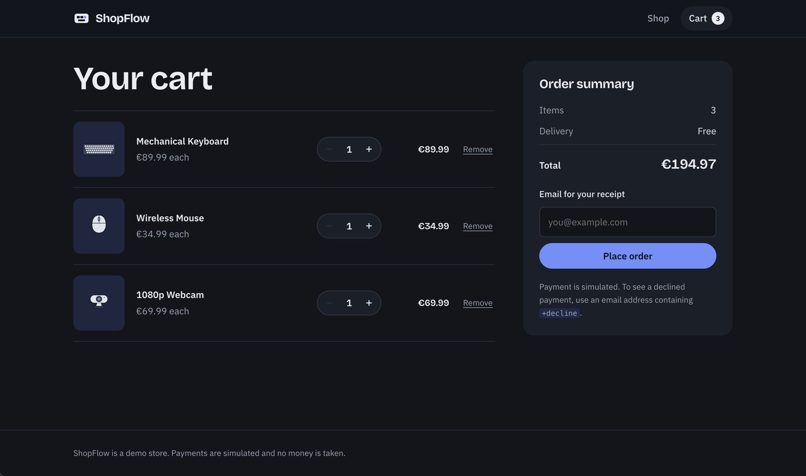

# ShopFlow


An event-driven microservices store and the enterprise Azure platform it runs on, built end to end:
six services in five languages, a Terraform landing zone, AKS, Azure DevOps pipelines that authenticate
with a managed identity, and GitOps releases with Argo CD, including canary releases in prod.

> **Status:** Phases 1–6 of 10 complete. The Azure environment is torn down to save cost; the
> screenshots are from the last live release. `cd infra && make bootstrap && make up` rebuilds it.


---

## What's in here

| Folder | What it holds | Pipeline |
|---|---|---|
| [`app/`](app) | Six services (Python, Java, Go, Node, Next.js) over Azure Service Bus, and a local stack that runs it all on a laptop | Test → build + Trivy scan + SBOM → release to dev → approval → promote to prod |
| [`infra/`](infra) | Terraform landing zone (hub-spoke, private DNS, ACR, Key Vault, AKS, Service Bus, guardrails) and the Ansible-built agent | Validate + Trivy IaC → plan → approval → apply the saved plan |
| [`gitops/`](gitops) | Helm chart, per-environment values, the Argo CD ApplicationSet and the canary setup | None: Argo CD pulls from it |

Each folder has its own README with the details, the design decisions and the problems I hit along the way.

## How it fits together


- **Each pipeline only runs for its own folder.** The release commit touches `gitops/` only, so it never starts another build.
- **No secrets in Azure DevOps.** The self-hosted agent signs in as its VM's managed identity, with role assignments limited by an ABAC condition. The only stored credential is a deploy key for this repository.
- **Prod runs exactly what dev ran.** Promotion copies the image tag that passed in dev; nothing is rebuilt.
- **Bad releases roll themselves back.** The prod frontend goes out as a canary: 50% of traffic, an automated health check, then 100%, or an automatic rollback.

## Screenshots

| | |
|---|---|
|  |  |
| App pipeline, all four stages | Infra pipeline, apply after approval |
|  |  |
| Prod canary: 50% → health check → 100% | Checkout in prod |

## Quick start

```bash
# Run the whole shop locally (Docker), including the Service Bus emulator
cd app && make up          # http://localhost:3000

# Build the Azure platform (needs an Azure subscription)
cd infra && make bootstrap && make up
```

## Roadmap

- [x] **Phase 1:** Six services, Dockerfiles, local stack with the Service Bus emulator
- [x] **Phase 2:** Terraform landing zone: hub-spoke network, private DNS, remote state, guardrails
- [x] **Phase 3:** AKS with Workload Identity, Cilium and Entra ID RBAC; real Service Bus
- [x] **Phase 4:** Ansible: hardened jump box and self-hosted Azure DevOps agent
- [x] **Phase 5:** Azure DevOps pipelines: templates, Trivy scanning, SBOMs, approvals, managed-identity auth
- [x] **Phase 6:** GitOps CD with Argo CD: dev and prod, approval-gated promotion, canary releases with Argo Rollouts
- [ ] Still to come from Phases 3–5: private API server, ingress with cert-manager, image signing
- [ ] **Phase 7:** Security: Key Vault, Kyverno, Defender for Containers, Azure Policy
- [ ] **Phase 8:** Observability: OpenTelemetry tracing, Grafana, SLOs, alerting
- [ ] **Phase 9:** Resilience: KEDA, k6 load tests, chaos testing, Velero DR
- [ ] **Phase 10:** Write-up and demo

Known follow-ups: a transactional outbox in the order service, and stock reservation as a saga.

## History

ShopFlow started as three repositories (`shopflow-app`, `shopflow-infra`, `shopflow-gitops`) and was
merged into this one with every commit kept: `git log -- app/` shows the application's full history.
The pipelines and Argo CD now point here. That wiring hasn't run against Azure yet, because the
environment was torn down before the move.
