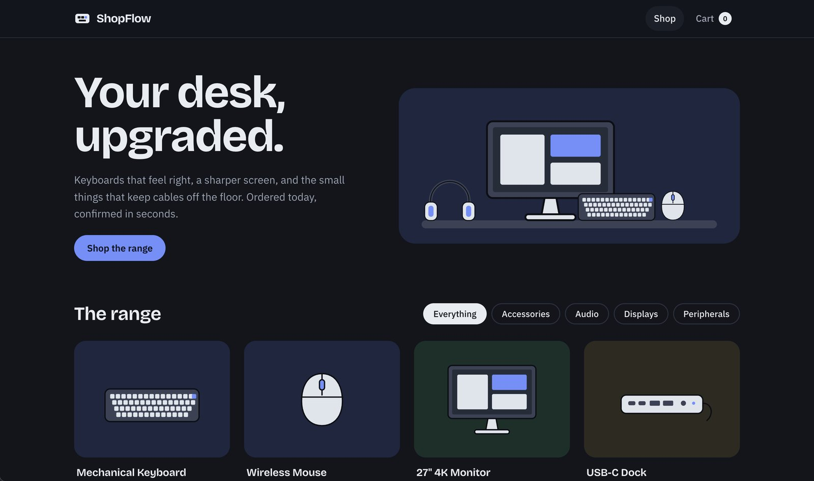
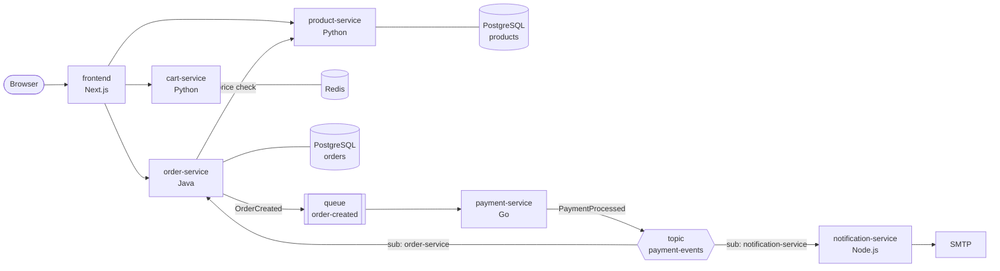
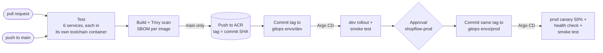
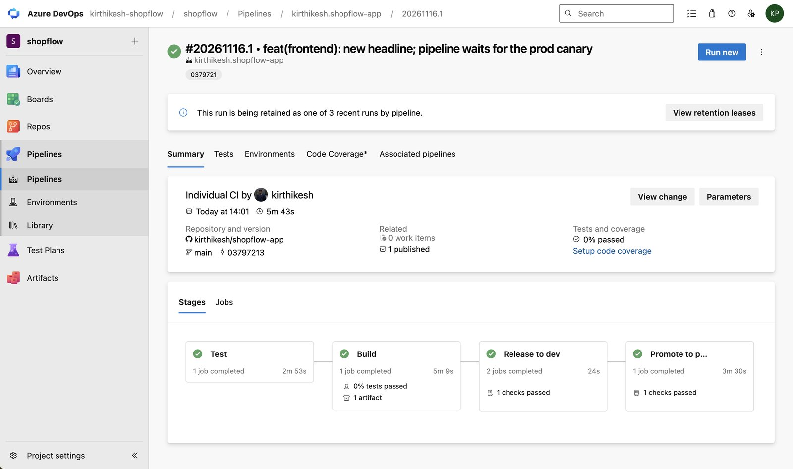

# ShopFlow · app


An event-driven microservices store, built as the application layer of an enterprise
platform on **Azure**: private AKS, Terraform landing zone, Azure DevOps pipelines, GitOps,
policy-as-code and full observability.

This folder holds the **application**: six services in five languages, plus a local stack
that runs the whole system on a laptop, including Azure Service Bus (through the official emulator).

> Part of the [ShopFlow monorepo](../README.md). Infrastructure lives in [`infra/`](../infra), deployment config in [`gitops/`](../gitops). The Azure environment is switched off to save cost; the screenshots are from the last live release.



---

## Architecture



### How an order flows

1. The browser calls the **frontend**, which forwards to internal services. The browser never reaches them directly.
2. **order-service** re-prices every line from **product-service**, ignoring any price from the client, saves the order as `PENDING_PAYMENT` and publishes `OrderCreated` to a **queue**.
3. **payment-service** consumes the queue, approves or declines, and publishes `PaymentProcessed` to a **topic**.
4. The topic fans out to two **subscriptions**:
   - **order-service** marks the order `PAID` or `PAYMENT_FAILED`
   - **notification-service** emails the customer
5. The order page polls until the status changes.

## Services

| Service | Stack | Data | Port |
|---|---|---|---|
| `frontend` | Next.js 16, React 19, TypeScript | — | 3000 |
| `product-service` | Python, FastAPI, SQLAlchemy | PostgreSQL | 8001 |
| `cart-service` | Python, FastAPI | Redis (TTL 7 days) | 8002 |
| `order-service` | Java 21, Spring Boot, JPA, Flyway | PostgreSQL | 8080 |
| `payment-service` | Go, `azservicebus` | — | 8083 |
| `notification-service` | Node.js, Express, Nodemailer | — | 8084 |

Every service exposes `/health` (liveness), `/ready` (readiness)¹ and `/metrics` (Prometheus).
They run as non-root users in multi-stage Docker images.

<sub>¹ Spring Boot uses `/health/liveness` and `/health/readiness`.</sub>

## Run it locally

Needs Docker Desktop with **at least 6 GB of memory** (the SQL Server behind the Service Bus emulator is heavy).

```bash
make up        # build and start everything
```

| | |
|---|---|
| Shop | http://localhost:3000 |
| Email inbox (Mailpit) | http://localhost:8025 |

The Service Bus emulator needs about a minute to start; the consumers retry until it's ready.

**Try a failed payment:** check out with an email containing `+decline`, e.g. `me+decline@example.com`.
Orders over €2,000 are also declined.

```bash
make logs      # follow the app logs
make down      # stop (keeps data)
make clean     # stop and delete all data
```

## Tests

Tests run inside containers, so no local Python, Java, Go or Node install is needed:

```bash
make test               # everything
make test-order         # one service
```

## CI/CD and GitOps

[`azure-pipelines.yml`](azure-pipelines.yml) runs in Azure DevOps on a self-hosted agent inside the
Azure hub network, and signs in to Azure as that VM's managed identity. The pipeline **never deploys
the app itself**: it commits the image tag to [`gitops/`](../gitops),
and **Argo CD** in the cluster rolls it out.



| Stage | What it does |
|---|---|
| Test | ruff and pytest (Python), Maven tests (Java), `go vet` and `go test`, Node tests, Next.js type check and production build |
| Build | Each image is scanned with Trivy. The build **fails on any CRITICAL vulnerability that has a fix**; every HIGH and CRITICAL finding is published to the Tests tab, and a CycloneDX SBOM per image is kept as a build artifact. Pushed only from `main` |
| Release to dev | Creates the namespace's secrets from Azure, commits the tag to `envs/dev`, waits until Argo CD has all six services on it, then smoke-tests through the real load balancer |
| Promote to prod | Waits for approval on `shopflow-prod`, then does the same for `envs/prod` with the **same tag**: nothing is rebuilt. The frontend goes out as a **canary** (Argo Rollouts): 50% of traffic, an automated health check, then full rollout, or automatic rollback if the check fails |

Both release stages are skipped automatically when the cluster is switched off. The only stored
credential is a **deploy key for this repository**, and the release commit only touches `gitops/`, so it
never starts the app or infra pipeline again (each pipeline only triggers on its own folder). Azure access
is the agent's managed identity.



Templates live in [`.azure-pipelines/templates`](.azure-pipelines/templates): managed-identity sign-in,
build-scan-push (reused for all six services) and the GitOps release (reused for both environments).

## Problems I hit, and how I fixed them

| Problem | Cause | Fix |
|---|---|---|
| Python tests: `ModuleNotFoundError: No module named 'app'` | Plain `pytest` doesn't put the service folder on the import path | `pyproject.toml` with `pythonpath = ["."]` in both Python services |
| **Trivy blocked the order-service image**: critical Tomcat (CVE-2026-65182) and Spring MVC CVEs | Spring Boot 3.5 left open-source support in June 2026, so its fixes are commercial only | Upgraded to **Spring Boot 4.1** (Spring Framework 7, Tomcat 11): new `webmvc` and `flyway` starters, and Jackson 3 (`tools.jackson`) |
| Deploy timed out: pods `Pending` on AKS | The single dev node was fully reserved, and rolling updates start the new pod before stopping the old one | Smaller CPU requests, and `maxSurge: 0` in the dev overlay |
| `order-service` stuck `Pending` after adding canaries | Argo Rollouts and a second prod frontend used the last free CPU on the node | Lowered its CPU request in `gitops/`; Argo CD rolled it out and the rerun went green |

## Design decisions

- **Database per service.** The product and order services each own a database; nothing reads another service's tables.
- **Server-side pricing.** The cart stores quantities only. The order service fetches prices itself, so a client can't change what it pays.
- **Money in integer cents.** No floating-point rounding anywhere.
- **Queue for commands, topic for events.** `OrderCreated` has one consumer, so it uses a queue. `PaymentProcessed` has two, so it uses a topic with a subscription each.
- **Idempotent consumers.** Stable message IDs with duplicate detection on, and a settled order never changes status on redelivery.
- **Dead-lettering.** Malformed messages go straight to the dead-letter queue; transient failures are retried up to 5 times first.

## Repository layout

```
app/
├── azure-pipelines.yml       CI/CD (Azure DevOps)
├── .azure-pipelines/templates/
├── docker-compose.yml        local stack
├── Makefile                  make up / test / deploy
├── deploy/k8s/               create-secrets.sh (manifests live in ../gitops)
├── local/
│   ├── postgres/init.sql     creates one database per service
│   └── servicebus/config.json  queue, topic and subscriptions for the emulator
└── services/
    ├── frontend/
    ├── product-service/
    ├── cart-service/
    ├── order-service/
    ├── payment-service/
    └── notification-service/
```

Related folders:
- [`infra/`](../infra): Terraform landing zone, Ansible, infrastructure pipeline
- [`gitops/`](../gitops): Helm chart, per-environment values, Argo CD, Argo Rollouts

## Roadmap

See the [project roadmap](../README.md#roadmap).
